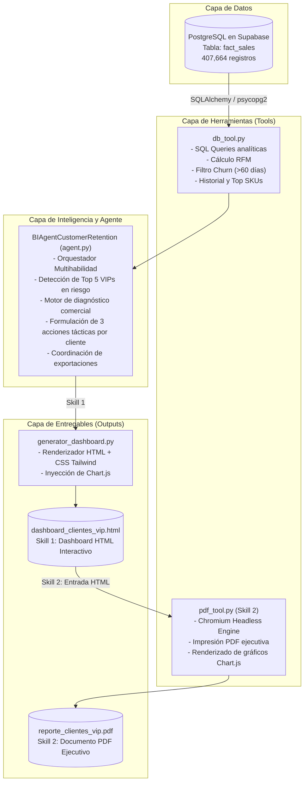

# 03. Arquitectura del Sistema Agéntico de BI

## 1. Diagrama de Arquitectura Multihabilidad

## 2. Componentes del Sistema

### 2.1 Base de Datos (Supabase PostgreSQL)
- **Tabla**: `fact_sales` (407.664 registros limpios del dataset Online Retail II).
- **Índices**: `idx_sales_date`, `idx_sales_customer`, `idx_sales_country`.

### 2.2 Herramienta de Acceso Analítico (`04_agente/tools/db_tool.py`)
- Implementa queries optimizadas para segmentar la base de clientes y calcular recencia (`days_inactive`), frecuencia (`order_count`) y valor monetario (`total_spent`).
- Extrae la cesta de productos más representativa de cada cliente VIP para personalizar las recomendaciones.

### 2.3 Agente de BI (`04_agente/agent.py`)
- Orquesta ambas habilidades (Skill 1 y Skill 2).
- Evalúa el perfil de compra (mayorista nacional vs internacional, frecuencia vs ticket medio).
- Genera un diagnóstico contextualizado del motivo de cese de compra.
- Formula **3 acciones accionables por cliente** categorizadas por canal, urgencia e impacto esperado.

### 2.4 Generador de Dashboard HTML (`04_agente/generator_dashboard.py`)
- Produce un archivo HTML autocontenido (`04_agente/outputs/dashboard_clientes_vip.html`) con diseño moderno (Tailwind CSS, Chart.js, tipografía profesional y responsive design).
- Incorpora directivas `@media print` y reglas CSS `break-inside: avoid;` para garantizar saltos de página limpios.

### 2.5 Motor de Exportación a PDF (`04_agente/tools/pdf_tool.py` - Skill 2)
- Utiliza Chromium Headless nativo (`msedge.exe` / `chrome.exe`) con flags optimizados para esperar la compilación de scripts JS antes de la captura.
- Produce el archivo PDF listo para su distribución ejecutiva o impresión formal: `04_agente/outputs/reporte_clientes_vip.pdf`.
